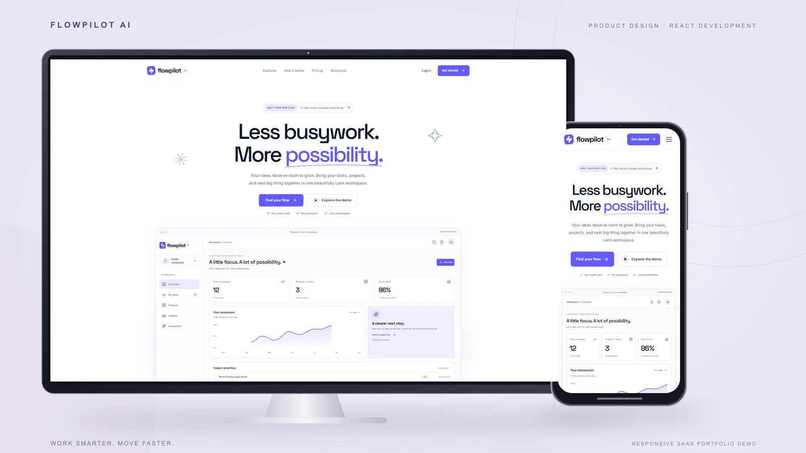

# FlowPilot AI

**Work Smarter. Move Faster.** A premium SaaS marketing website and interactive productivity workspace, created by Awal Jan Hematyar as a fictional portfolio demonstration.



[Source on GitHub](https://github.com/awaljanhematyar/flowpilot-ai). Production URL will be added after verification.

## Features

- Editorial homepage, features, walkthrough, about and contact pages.
- Three illustrative USD plans with monthly/yearly billing and an exact 20% yearly discount.
- Six original articles, combined search/category filters, detail pages and related reading.
- Password-free demo entry, simulated session persistence and logout.
- Separate responsive dashboard with overview, tasks, projects, insights and assistant views.
- Full task CRUD, completion, search, priority/status/project filtering and stable UUIDs.
- Validated, versioned LocalStorage, corrupted-data recovery and a current-visit fallback.
- Project progress derived from local tasks, fictional SVG insights, activity and notifications.
- Four honestly labeled predefined planning scenarios, with no external AI calls.
- Native dialogs, focus containment and return, Escape dismissal, visible focus and reduced motion.

## Run and verify

Use Node.js 24 LTS and npm. No API keys or application environment variables are needed.

```sh
npm ci
npm run dev
npm run build
npm run preview
npm run lint
npm test
```

Vite normally serves at `http://127.0.0.1:5173`. With the app running, `npm run test:browser` uses the installed Microsoft Edge browser through Playwright. It checks routes, responsive overflow at 375/768/1024/1440px, CRUD and reload persistence, pricing, resources, forms, keyboard controls, mobile navigation, suggestions, logout and runtime errors. Screenshots go to `docs/screenshots/` and evidence to `docs/browser-report.json`. Set `TEST_BASE_URL` to check a production origin.

`npm run cover` composites actual desktop/mobile browser captures into original device frames, producing a 1600×900 PNG and WebP in `docs/portfolio/`. It never redraws or invents the interface.

See [QA evidence](docs/QUALITY.md) for actual results and limits. Automated axe scans supplement keyboard checks; they are not a full assistive-technology audit.

## Routes

| Route | Experience |
| --- | --- |
| `/` | Homepage and workspace preview |
| `/features` | Product capabilities |
| `/how-it-works` | Three-step walkthrough |
| `/pricing` | Illustrative plans and billing toggle |
| `/resources` | Searchable article library |
| `/resources/:slug` | Article and related reading |
| `/about` | Story, demo and privacy notes |
| `/contact` | Validation and simulated feedback |
| `/login`, `/signup` | Password-free entry |
| `/dashboard` | Simulated-access workspace |
| Other paths | Custom 404 |

`/blog` redirects to `/resources`. Workspace views use `/dashboard?view=tasks`, `projects`, `insights`, or `assistant`.

## Architecture and customization

React 19, Vite, JavaScript, Tailwind CSS v4, React Router and Lucide React. Charts and illustrations use SVG/CSS. Inter and Space Grotesk fonts are self-hosted. ESLint, Vitest, React Testing Library, Playwright and axe support QA.

- `src/components/`: reusable UI, marketing shell, chart and preview.
- `src/pages/`: marketing pages and interactive dashboard.
- `src/data/content.js`: original articles, fictional records, prices and suggestions.
- `src/hooks/`: local task state and persistence feedback.
- `src/utils/storage.js`: storage schema, billing calculations and article filters.
- `src/index.css`: design tokens, layouts and responsive styles.
- `src/test/` and `tests/`: behavioral and browser acceptance tests.
- `scripts/`: portfolio composition and explicit publication helpers.
- `docs/`: verification evidence, screenshots and portfolio assets.

The browser stores `flowpilot.tasks.v1` and `flowpilot.session.v1`. Dashboard **Demo data options** restores sample tasks or clears local tasks. Logout removes the session flag and retains tasks.

## Vercel deployment

Import the GitHub repository with the **Vite** preset, Node.js 24, install command `npm ci`, build command `npm run build` and output directory `dist`. `vercel.json` supplies the SPA fallback and basic response headers while static assets are served directly. Verify direct nested routes after deployment.

Optional publication helpers use existing Git/Vercel credentials in process memory. They never log or save credentials, are scoped to this owner's FlowPilot project, and do not run during builds. Standard Vercel imports do not need them.

## Honest demo boundaries

This is a fictional portfolio project. There is **no live AI, real authentication, secure account, subscription, payment processing, backend or team synchronization**. Plan benefits are concepts; every plan opens the same demo. Suggestions are predefined, not personalized, and do not analyze tasks.

Tasks and a non-sensitive session flag stay in this browser when storage is available. Avoid sensitive information. Contact details are only validated in memory; nothing is transmitted or saved. Activity resets between visits. Charts and notifications are illustrative; task counts and project progress reflect local records.

A production service would need a backend, secure authentication and authorization, privacy controls, audited integrations, billing and monitoring. None is implied by this frontend.

## License and credits

Original code and content are [MIT licensed](LICENSE). Fonts and icons retain their licenses; see [asset attribution](docs/ATTRIBUTION.md). No customer endorsements, usage metrics or research claims are fabricated.
